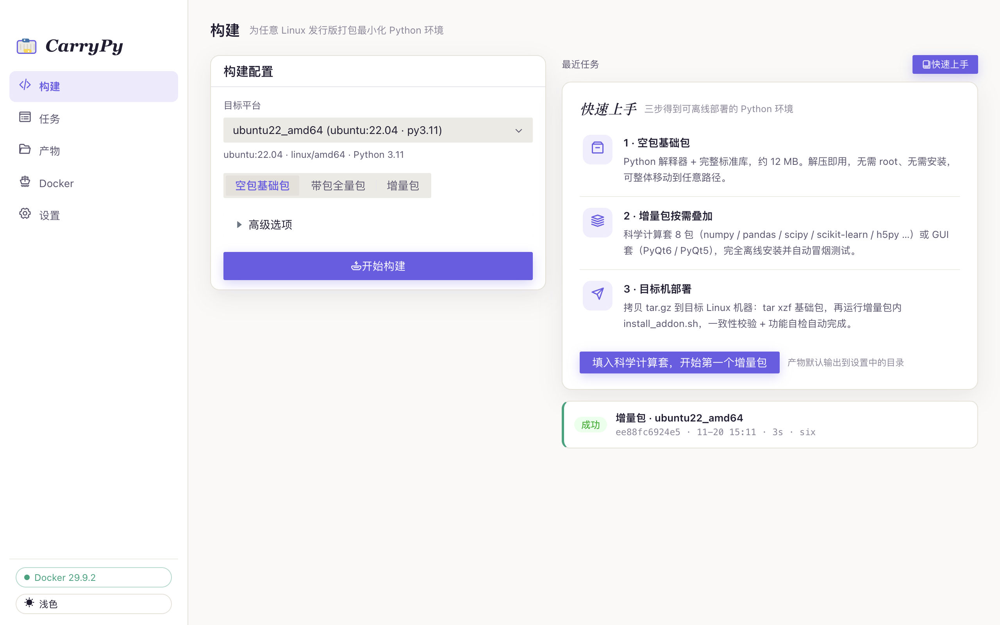

中文 | [English](README_en.md)


# CarryPy — 跨平台最小化 Python 环境打包工具


基于 Docker **为任意版本的 Linux 发行版构建任意版本的 Python** 运行环境——
**最小体积、可离线部署、免安装**, 并支持后续**增量添加 Python 新包**。

## 方式一: 直接使用现成产物 (推荐)

从 [Releases](https://github.com/yueshaosheng/CarryPy/releases) 下载:

- **基础包** `mini_python-<平台>-py<版本>.tar.gz` — Python 解释器 + 完整标准库
- **科学计算增量包** `addon-<平台>-numpy+...+h5py.tar.gz` —
  numpy / matplotlib / pandas / seaborn / openpyxl / scipy / scikit-learn / h5py, 可选
- **GUI 增量包** `addon-<平台>-pyqt6.tar.gz` — PyQt6 (ubuntu18 为自编 Qt 6.2 运行时版);
  centos7 为 pyqt5 版; centos6 (glibc 2.12) 无可行 GUI 包, 可选

拷到目标机 (完全离线也行):

```bash
# 1. 解压基础包即用 (无需 root / 无需安装)
tar xzf mini_python-ubuntu22_amd64-py3.11.16.tar.gz
./mini_python/selfcheck.sh                # 自检
./mini_python/python3 your_script.py      # 运行脚本
./mini_python/pip3 list                   # 查看已装包

# 2. (可选) 安装增量包 (以科学计算套为例)
tar xzf addon-ubuntu22_amd64-numpy+matplotlib+pandas+seaborn+openpyxl+scipy+scikit-learn+h5py.tar.gz
./addon-*/install_addon.sh ./mini_python  # 离线安装 + 自动冒烟测试
```

目录可整体移动到任意路径。

## 方式二: 自己构建 (打包机需安装 Docker)

**先确认平台配置文件** `config/<平台>.conf` (按需修改)——它定义了目标平台、
Python 版本和预装包, 构建命令通过 `-p <平台>` 读取它:

```bash
cat config/ubuntu22_amd64.conf
# BASE_IMAGE="ubuntu:22.04"       # Docker 基础镜像 (需与目标机一致)
# DOCKER_PLATFORM="linux/amd64"   # 目标架构
# PYTHON_VERSION="3.11"           # Python 主.次版本 (自动解析最新 patch)
# DEFAULT_PACKAGES="numpy matplotlib pandas seaborn openpyxl"  # 全量构建的预装包
```

**然后构建:**

```bash
# 构建空包基础包 (首次约 5~10 分钟)
./build.sh -p ubuntu22_amd64 --packages ""

# 构建增量包 (复用构建镜像, 镜像缺失时自动补建)
./build_addon.sh -p ubuntu22_amd64 scipy scikit-learn

# — 或一步到位: 带预装包的全量包 (首次约 20~40 分钟)
./build.sh -p ubuntu22_amd64
```

产物在 `dist/`, 部署方式同"方式一"。

支持平台: Ubuntu 18/20/22/24、Debian 11/12、CentOS 6/7、Rocky 8/9
(每个平台一个配置文件, 见 `config/`; 扩展新平台见进阶指南)。

## 桌面 GUI

`desktop/` 提供 Electron + React + TypeScript 桌面应用: 平台/预设选择、一键构建、
实时日志、任务取消与历史恢复、产物管理(删除可撤销)、Docker 状态、明暗主题。



```bash
cd desktop
npm install
npm run dev          # 开发态 (产物写入仓库 dist/)
npm run dist:mac     # 打包 macOS dmg → desktop/release/
npm run test:e2e     # Playwright 端到端测试
```

**[应用下载页](docs/download.html)** — 浏览器打开即可, 自动检测系统/架构,
提供 macOS / Windows / Linux 安装包 (GitHub Actions 矩阵构建, 推送 `gui-v*` tag 自动发布到 Releases)。
打包态产物默认输出到 `~/CarryPy-dist` (设置中可改)。macOS 首次打开若被 Gatekeeper 拦截:
右键 → 打开, 或 `xattr -dr com.apple.quarantine /Applications/CarryPy.app`。
Windows 执行构建需安装 Git for Windows (Git Bash)。

## 常见报错

| 报错 | 解决 |
|---|---|
| `错误: docker 守护进程未运行` | 先启动 Docker Desktop (macOS: `open -a Docker`), 用 `docker info` 验证 |
| `错误: 未安装 docker` | 安装 Docker Desktop (或 Colima / OrbStack / Rancher Desktop) |

更多报错与详细排查: [进阶指南 - 常见报错](docs/ADVANCED_zh.md#常见报错)

## 进阶指南

工作原理、目录结构、产物体积与构建时间参考、全量构建完整选项、GUI (Qt) 增量包、
扩展新平台、BASE_IMAGE 写法、Docker 镜像清理、全部注意事项:

**→ [docs/ADVANCED_zh.md](docs/ADVANCED_zh.md)**
